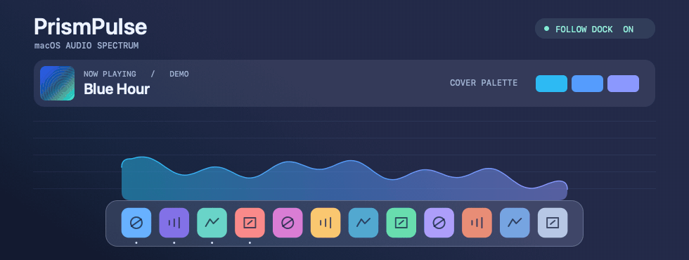
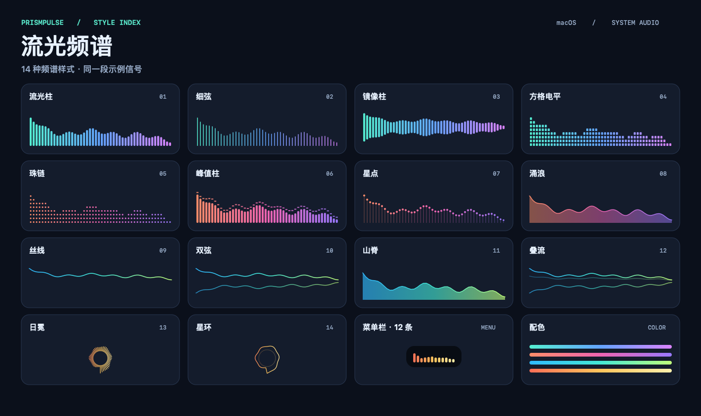

# PrismPulse · 流光频谱

> Working alone in front of a screen gets dull! Visualize the background music you work to. Give your screen a little movement and life.

[简体中文](README.md) · English · [Download the latest release](https://github.com/DaveBraid/PrismPulse/releases/latest)

PrismPulse is a live system audio visualizer for macOS. Let your music, videos, or games animate a spectrum above the Dock, in the menu bar, or in a floating window anywhere on your screen.



*The demo uses the app's spectrum renderer and color extraction code with a simulated Dock and sample covers.*

## Features

- **Follow the Dock.** Keep the spectrum centered just above the bottom Dock. It follows the Dock's width and leaves room for its rounded corners. Set the height and corner radius separately. Pick the wave style (「涌浪」) and turn off the dark backdrop for a transparent wave that meets the top of the Dock.
- **Extract colors from artwork.** PrismPulse blends colors from the current album cover or video thumbnail by default. Colors transition smoothly from the fallback palette and between covers. It can read artwork from Music, Spotify, Tabbit, Chrome, and Safari. Choose a fallback palette, a single color, or a custom two-color gradient.
- **14 spectrum styles.** Choose from bars, beads, waves, and rings. The floating window supports always on top, click-through, opacity, and drag resizing. The menu bar spectrum supports adjustable width, automatic fit, and a fully transparent background.
- **Fade out in silence.** The window fades away when playback goes quiet and fades in when sound returns. Choose a fixed frame rate or follow the current display. Audio checks slow down when idle.
- **Make room for full-screen apps.** Under 「悬浮窗 → 应用全屏时」, choose to fade out or draw flush against a screen edge. The top spectrum expands downward. Left and right edges rotate vertically and expand inward. Set 「贴边长度」 to 10%–100% of the display width, capped at the display height on vertical edges. The previous position and Dock alignment return afterward. The default keeps the current behavior. Detection follows the native full-screen Space on the visualizer's display.
- **Update in the app.** PrismPulse checks GitHub releases daily by default. You can also choose 「检查更新…」 in the menu or settings. Confirm installation to download, verify the signatures, replace the app, and relaunch. Automatic checks can be disabled in settings.

<details>
<summary>See all 14 styles</summary>



</details>

## Install

Requires **macOS 14.4 or later**. The universal download supports Apple silicon and Intel Macs.

1. Open [Releases](https://github.com/DaveBraid/PrismPulse/releases/latest) and download `PrismPulse-macOS.zip` from Assets.
2. Unzip it, drag `PrismPulse.app` into Applications, and open it.
3. Allow system audio recording. Click the waveform in the menu bar to open settings, then play some music or a video.

The release is ad hoc signed and has not been notarized by Apple. If macOS blocks the first launch and you have confirmed the download came from this repository, go to **System Settings → Privacy & Security** and choose **Open Anyway** after trying to open the app. [Apple's instructions](https://support.apple.com/en-us/102445)

If you use 0.7 or earlier, install 1.0 manually once to enable future in-app updates.

## Quick start

The app uses Chinese labels. These are the settings to look for.

- **Snap to the Dock.** Put the Dock at the bottom of your display. In settings, enable 「跟随 Dock」 under 「悬浮窗」. Drag the floating window to move it or drag its bottom-right corner to resize it. While it follows the Dock, set the height in settings.
- **Use browser artwork.** With media playing, open 「授权取色」 under 「封面来源」 in settings and select your browser. In Tabbit and Chrome, enable **View → Developer → Allow JavaScript from Apple Events**. In Safari, the option is under **Settings → Developer → Automation**. PrismPulse looks for Media Session artwork first and can also use video posters or page images.
- **Check audio.** The menu's demo mode (「演示动画」) needs no recording permission. If the spectrum stays still during playback, check **System Settings → Privacy & Security → Screen & System Audio Recording**, then choose 「重连系统音频」 to reconnect.

Audio analysis and artwork color extraction run locally. PrismPulse captures system output through a Core Audio Process Tap. It does not save or upload audio.

## Build from source

Install Xcode or Command Line Tools with Swift 6 and the macOS 14.4 SDK or later. The first build downloads a pinned version of the Sparkle update framework through Swift Package Manager.

```sh
git clone https://github.com/DaveBraid/PrismPulse.git
cd PrismPulse
./Scripts/build.sh
open build/PrismPulse.app
```

Run `swift run -c release SpectrumCheck` for the core checks. The floating window and menu bar share spectrum data computed with Accelerate vDSP. The UI uses AppKit, Core Graphics, and SwiftUI.

Implementation references include [Apple Core Audio Taps](https://developer.apple.com/documentation/coreaudio/capturing-system-audio-with-core-audio-taps), [AudioCap](https://github.com/insidegui/AudioCap), [Nowsee](https://github.com/Sergio-prog/Nowsee), and [Hammerspoon's Space queries](https://github.com/Hammerspoon/hammerspoon/blob/master/extensions/spaces/libspaces.m). Full-screen detection uses a private, read-only Space layout API with an AppKit presentation-state fallback. macOS updates may affect detection.

## Publish future updates

Prepare a universal arm64/x86_64 app bundle and release notes. Generate signed update assets, then publish both the ZIP and `appcast.xml` on GitHub Releases.

```sh
./Scripts/prepare-update.sh build/PrismPulse.app release-notes.md
version=$(/usr/libexec/PlistBuddy -c 'Print :CFBundleShortVersionString' build/PrismPulse.app/Contents/Info.plist)
git push origin main
gh release create "v$version" \
  "build/releases/v$version/PrismPulse-macOS.zip" \
  "build/releases/v$version/appcast.xml" \
  "build/releases/v$version/SHA256SUMS" \
  --target "$(git rev-parse HEAD)" --notes-file release-notes.md --latest
```

Increment `CFBundleVersion` and update `CFBundleShortVersionString` for each release. The private update-signing key stays in the macOS login Keychain under `local.ethanlee.PrismPulse`. Keep that key and the app's public key for subsequent releases. The script uses Sparkle's SwiftPM tools by default. Set `SPARKLE_TOOLS_DIR` to use another tool directory.

## License

Updates use [Sparkle](https://sparkle-project.org/). Its license is included in the application bundle.

[MIT](LICENSE)
