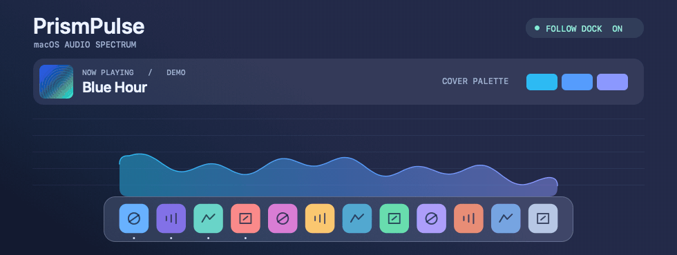
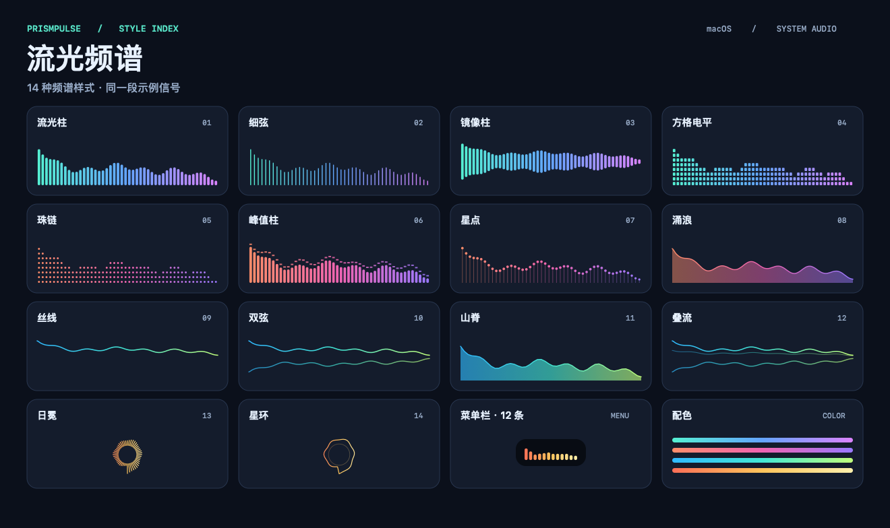

# 流光频谱 · PrismPulse

> 一个人干活对着屏幕太枯燥了！在屏幕上可视化你的工作 BGM 吧！给你的屏幕增添一些灵动与生气

简体中文 · [English](README.en.md) · [下载最新版](https://github.com/DaveBraid/PrismPulse/releases/latest)

PrismPulse 是 macOS 的实时系统音频频谱。让正在播放的音乐、视频或游戏声音在 Dock 上方跳动，也可以把频谱放进菜单栏，或者悬浮在屏幕任意位置。



*演示使用应用的频谱渲染和取色代码。Dock 与封面为示例素材。*

## 特色功能

- **跟随 Dock**。频谱居中贴在底部 Dock 上方，随 Dock 宽度伸缩，两侧给圆角留出空间。高度和圆角都能单独调。选「涌浪」并关闭「深色底板」，就能得到一条贴着 Dock 的透明彩色波形。
- **自动提取封面颜色**。默认把当前专辑封面或视频缩略图配成渐变。备用配色到封面配色、换封面时都平滑过渡。可从 Music、Spotify、Tabbit、Chrome 和 Safari 取色。封面不可用时使用备用配色，也可以自己设定单色或双色渐变。
- **14 种频谱样式**。从光柱、珠链到波形和环形。悬浮窗支持置顶、点击穿透、透明度和拖动缩放。菜单栏频谱可调长度，支持自适应铺满和全透明背景。
- **有声时跳动，安静时淡出**。静音后浮窗自动淡出，声音回来时淡入。帧率可选固定档或「跟随屏幕」。静音时降低音频检查频率。
- **全屏时自动避让**。在「设置 → 悬浮窗 → 应用全屏时」选择淡出隐藏或贴边显示。频谱基线直接贴住屏幕边界，顶部向下展开，左右自动旋转为纵向并朝屏幕内部展开。「贴边长度」按屏幕宽度的 10%–100% 缩放，左右最长限制在屏幕高度内。退出全屏后恢复原位置和 Dock 跟随。默认保持原样，按浮窗所在屏幕的原生全屏状态判断。
- **应用内更新**。默认每天自动检查 GitHub 发布的新版本，也可从菜单栏或设置中点「检查更新…」。发现更新后，点击安装即可完成下载、签名验证、替换和重启。可在设置中关闭自动检查。

<details>
<summary>查看 14 种样式</summary>



</details>

## 安装

需要 **macOS 14.4 或更新版本**。通用安装包支持 Apple Silicon 和 Intel Mac。

1. 打开 [Releases](https://github.com/DaveBraid/PrismPulse/releases/latest)，在 Assets 下载 `PrismPulse-macOS.zip`。
2. 解压，把 `PrismPulse.app` 拖入「应用程序」并打开。
3. 允许系统音频录制权限。点菜单栏的波形图标打开设置，播放一段音乐或视频即可看到频谱。

安装包采用临时签名，未经 Apple 公证。如果 macOS 提示无法验证，确认文件来自本仓库后，可在首次尝试打开后到「系统设置 → 隐私与安全性」选择「仍要打开」。[Apple 的打开说明](https://support.apple.com/zh-cn/102445)

0.7 及更早版本需要先手动安装一次最新版，后续版本可在应用内更新。1.0.0 的更新入口在部分网络下会返回 504，使用该版时请手动升级到 1.0.1。

## 快速上手

- **贴到 Dock 上方**。把 Dock 放在屏幕底部，在「设置 → 悬浮窗」勾选「跟随 Dock」。拖动浮窗可摆放位置，拖右下角可缩放。贴合时可在设置里调整高度。
- **用浏览器封面配色**。播放媒体后，在「设置 → 封面来源 → 授权取色」选择对应浏览器。Tabbit 和 Chrome 需要在「显示 → 开发者」开启「允许 Apple 事件中的 JavaScript」。Safari 的开关在「设置 → 开发者 → 自动化」。网页优先读取播放器提供的 Media Session 封面，也会尝试视频海报和页面封面。
- **检查音频**。菜单里的「演示动画」无需录音权限。如果有声音但频谱不动，检查「系统设置 → 隐私与安全性 → 屏幕与系统音频录制」，再点菜单里的「重连系统音频」。

音频分析和封面取色都在本机运行。PrismPulse 通过 Core Audio Process Tap 获取系统输出，音频不保存、不上传。

## 从源码构建

安装带 Swift 6 和 macOS 14.4 或更新 SDK 的 Xcode 或 Command Line Tools。首次构建会通过 Swift Package Manager 下载固定版本的 Sparkle 更新框架。

```sh
git clone https://github.com/DaveBraid/PrismPulse.git
cd PrismPulse
./Scripts/build.sh
open build/PrismPulse.app
```

核心检查可用 `swift run -c release SpectrumCheck` 运行。频谱计算使用 Accelerate vDSP，悬浮窗和菜单栏共用分析结果。界面使用 AppKit、Core Graphics 和 SwiftUI。

实现参考 [Apple Core Audio Taps](https://developer.apple.com/documentation/coreaudio/capturing-system-audio-with-core-audio-taps)、[AudioCap](https://github.com/insidegui/AudioCap)、[Nowsee](https://github.com/Sergio-prog/Nowsee) 和 [Hammerspoon 的空间查询](https://github.com/Hammerspoon/hammerspoon/blob/master/extensions/spaces/libspaces.m)。全屏识别使用只读的非公开空间布局接口，接口不可用时退回 AppKit 的展示状态。macOS 更新可能影响识别。

## 发布后续更新

准备好包含 arm64 和 x86_64 的通用版应用及发布说明后，执行以下命令。脚本会生成签名安装包、签名更新信息和校验值。先发布 Release，再把签名更新信息提交到仓库，供应用检查。

```sh
./Scripts/prepare-update.sh build/PrismPulse.app release-notes.md
version=$(/usr/libexec/PlistBuddy -c 'Print :CFBundleShortVersionString' build/PrismPulse.app/Contents/Info.plist)
git push origin main
gh release create "v$version" \
  "build/releases/v$version/PrismPulse-macOS.zip" \
  "build/releases/v$version/appcast.xml" \
  "build/releases/v$version/SHA256SUMS" \
  --target "$(git rev-parse HEAD)" --notes-file release-notes.md --latest
cp "build/releases/v$version/appcast.xml" appcast.xml
git add appcast.xml
git commit -m "Publish signed update feed for v$version"
git push origin main
```

发布前递增 `CFBundleVersion` 并更新 `CFBundleShortVersionString`。更新签名私钥保存在本机登录钥匙串的 `local.ethanlee.PrismPulse` 账号下，后续发布需保留同一密钥和应用公钥。脚本默认使用 SwiftPM 下载的 Sparkle 工具，也可用 `SPARKLE_TOOLS_DIR` 指定工具目录。

## 许可证

更新功能使用 [Sparkle](https://sparkle-project.org/)，安装包中包含其许可证。

[MIT](LICENSE)
